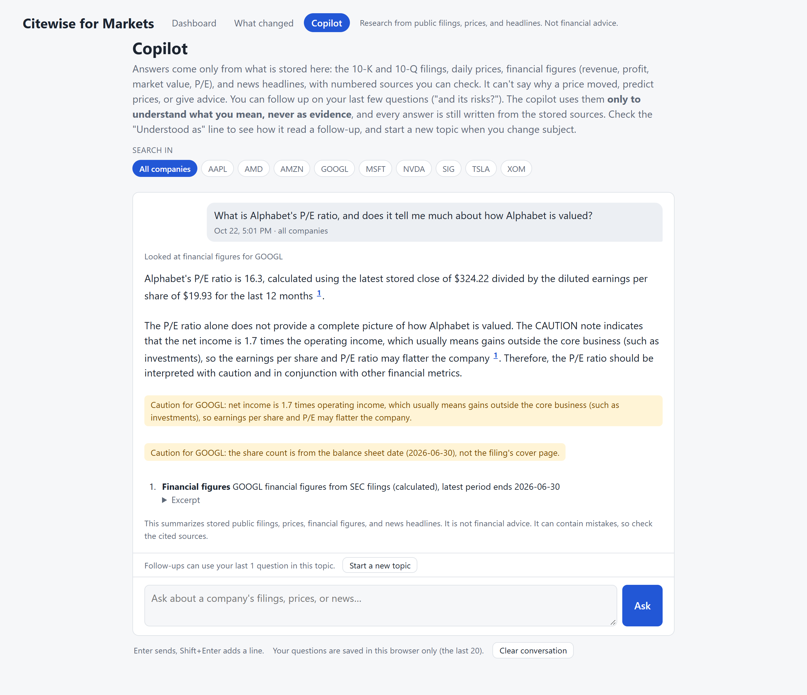
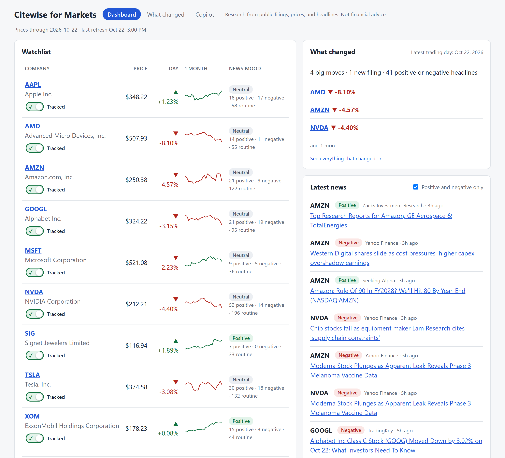
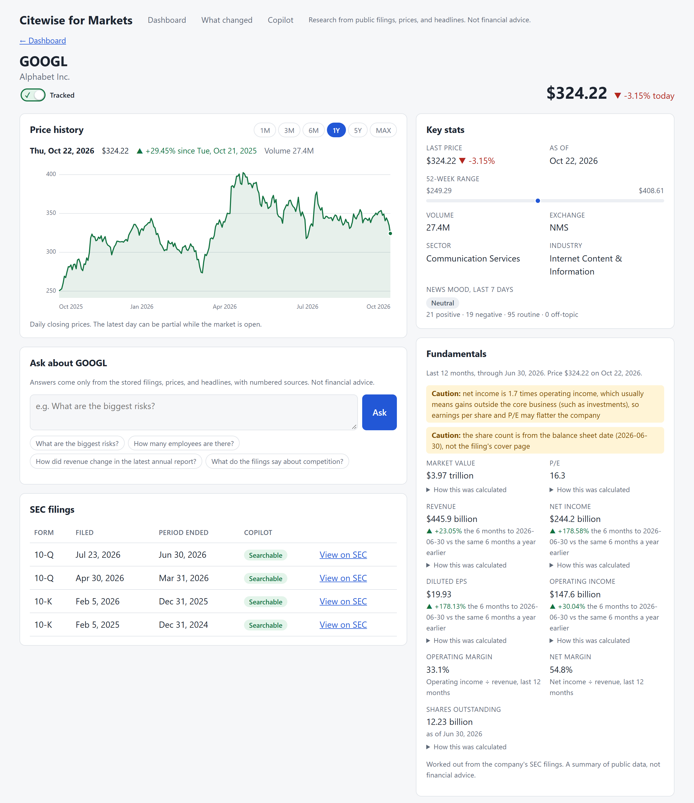
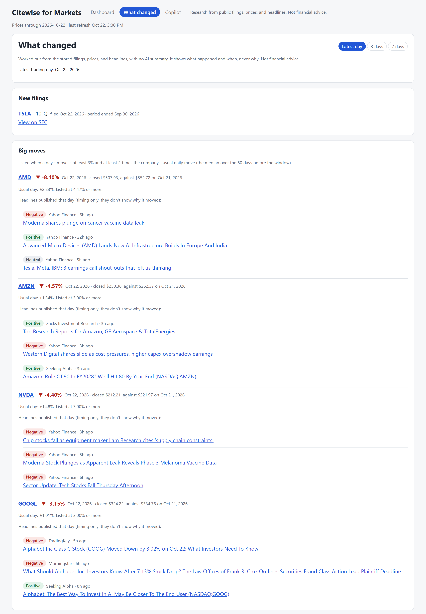
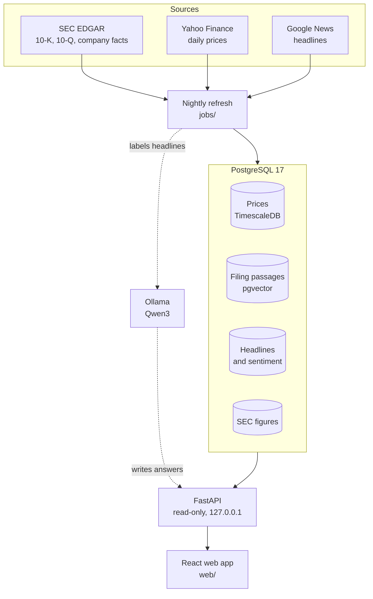
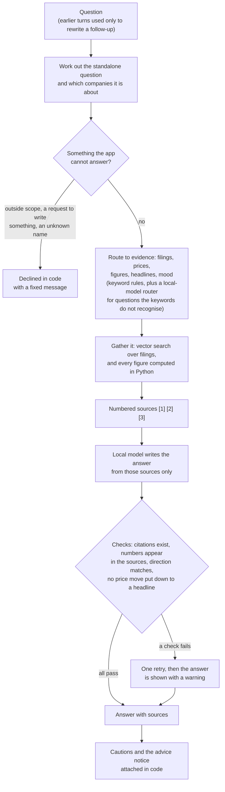

# Citewise for Markets

[](https://github.com/Nbhaskell/stockMarket/actions/workflows/ci.yml)

**A local-first research copilot for public companies.** Ask a question in plain English and get an answer written only
from SEC filings, daily prices, financial figures, and news headlines. Every claim carries a numbered citation, and every
number is checked against the source it cites.

It runs on one PC with a local model, costs nothing to run, and keeps its own Postgres database fresh with a nightly job.
It is a research tool, not a trading tool: it refuses to say whether to buy or sell, and it says so in code.

> **Prototype data only. Not financial advice.** Prices (Yahoo Finance) and headlines (Google News) come from free,
> unofficial sources that are not licensed for a public product. SEC EDGAR is public. The copilot summarizes stored data
> and can be wrong.

## See it

Screenshots of the running app, taken on 2026-10-22 from its own stored data.

**The copilot answers from stored figures and shows its cautions.** The P/E is worked out in Python from the SEC filings,
the model only quotes it as source 1, and the two yellow cautions are attached in code, not written by the model.



**Dashboard:** the watchlist with trend and news mood, a summary of what changed on the latest trading day, and the latest
positive and negative headlines.



**Stock page:** a price chart, key stats, and fundamentals, where each figure has its calculation one click away and the
cautions appear above the numbers they affect.



**What changed:** new filings and unusually large moves, each measured against that company's own usual day. The headlines
beside a move are labeled as timing only, because they cannot show why a price moved.



## What makes it interesting

- **Every number is checked.** The model sees only numbered sources, and each figure in its answer must appear in a source
  it cited. A sentence that says a stock *fell* when the stored data shows a rise is flagged, and so is a price move
  explained by a headline (headlines cannot show why a price moved). A failed check gets one retry, then a visible warning.
- **Python does the maths; the model only quotes.** Price changes, 52-week ranges, trailing-twelve-month revenue, margins,
  and P/E are computed from raw figures stored from the SEC. Each carries its recipe and source filings, and cautions are
  attached in code where a correct number can still mislead (for example, Alphabet's P/E is flattered by investment gains).
- **Safety rules live in code, not in the prompt.** A request for a buy, sell, or hold call always carries a fixed notice.
  Questions about things the app does not store, requests to write an email, and unknown company names are declined before
  the model is called. Earlier turns of a chat are used only to rewrite a follow-up into a standalone question, never as
  evidence (a test guards this).
- **It is measured, and the scores are reported as they came out.** See the table below.
- **It is run like a service.** A nightly job with a database lock and per-company isolation, desktop alerts for a bad
  night, and backups that only count once they have been restored into a throwaway database and matched row for row.
  The web app's types are generated from the API, so the screens cannot drift from the backend.
- **Local and swappable.** Postgres (TimescaleDB for prices, pgvector for filings), a local Qwen3 model through Ollama, and
  data sources, embedder, and chat model each behind an interface. Adding a Claude provider means writing one class and registering it.

## How it fits together



### How the copilot answers



## How well does it work?

The routing rules (which kind of evidence a question needs) are word lists, and every list has missed on the next
wording a person tries. So each round of fresh questions was written in new wording and run **once before any tuning**,
and the score is the one reported. A question set is spent after it has been run and joins the tuning material.

| Round | Cases | Score |
|---|---|---|
| Held-out round 1 | 36 | 78 of 108 (72%) |
| Held-out round 2 | 35 | 68 of 105 (65%) |
| Fresh round after that (deliberately harder) | 35 | 48 of 105 (46%) |
| Sealed round 3, keywords only / with the local-model router | 43 | 25 of 43 (58%) / 30 of 43 (70%) |
| Sealed round 4, keywords only / with the router | 47 | 31 of 47 (66%) / 37 of 47 (79%) |
| Sealed round 5, keywords only / with the router | 46 | 30 of 46 (65%) / 36 of 46 (78%) |

The first three rows ran every case three times (36 cases x 3 = 108); the sealed rounds ran each case once. Scores from
different rounds are not the same bar, because the questions and some of the checks changed. The agreed
stopping rule (stop tuning keywords at 85 to 90 percent on two rounds in a row) has **not** been met, and the worst misses
are written up case by case in [docs/DECISIONS.md](docs/DECISIONS.md). A confident wrong answer matters more than a refusal,
which is why the checks above run in code.

## Try it

Needs Docker Desktop, Python 3.10 or later, Node.js, and [Ollama](https://ollama.com) with `qwen3:latest`. It was
developed and is run on Windows 11; the Python and web code do not depend on Windows, but the launch scripts, task
scheduling, and desktop alerts are PowerShell, and the commands below are written for PowerShell.

```bash
cp .env.example .env        # set POSTGRES_PASSWORD (also inside DATABASE_URL) and SEC_USER_AGENT
docker compose up -d
python -m venv .venv
.venv\Scripts\python -m pip install -r requirements.txt
.venv\Scripts\python db/migrate.py
ollama pull qwen3:latest
.venv\Scripts\python -m jobs.add_company AAPL MSFT NVDA    # prices, news, filings, figures, search index, sentiment
npm --prefix web install
powershell -ExecutionPolicy Bypass -File scripts\start.ps1  # database check, API, and web app on http://localhost:5173
```

Adding a company downloads its filings, embeds them, and scores its headlines with the local model. On the development PC
(an RTX 3080), a clean install ran these exact commands in about 7 minutes: 1 for the Python packages, 5 for the three
companies, and the rest for the web packages, the database, and startup. Full instructions, including loading each data
type separately, are in [docs/SETUP.md](docs/SETUP.md).

## What is in it

| Screen | What it shows |
|---|---|
| Dashboard | Watchlist with price, daily change, one-month trend, and news mood; a "What changed" card; the latest positive and negative headlines; data-freshness warnings; a copilot box; an "Add a company" box |
| Stock page | Interactive price chart (1M to MAX), key stats, fundamentals with the calculation and source filings behind each figure, news, SEC filings, and a copilot limited to that company |
| What changed | New filings, unusually large moves (measured against each company's own usual day, with market-wide days labeled), and notable headlines, over the latest day, 3 or 7 trading days, or since your last visit. Computed in Python, with no AI summary |
| Copilot | A full-page chat with follow-ups, saved history in the browser, a company filter, and an "Understood as" line showing how a follow-up was read |

Under it: a data layer (prices, headlines, filings, and SEC figures in one Postgres database), an AI layer (chunking,
local embeddings, search, copilot, sentiment), a nightly job, a read-only API (plus two approved writes: adding and
removing a company), and the React app. The suite has about 3,000 Python tests and 300 web tests, which use fakes for every
outside service, so most of them need no network and no model.

## Data sources and licensing

The sources are documented here and in [docs/ARCHITECTURE.md](docs/ARCHITECTURE.md), and no unlicensed data is committed to
this repository. The app downloads its own data onto your machine when you run it (see "Try it"), so there is no price,
headline, or filing dataset in the repo to redistribute.

| Source | Used for | Status |
|---|---|---|
| SEC EDGAR | 10-K and 10-Q filings, reported financial figures | Public data. The app sends a contact email in its request header, as the SEC requires, and stays under its request limit |
| Yahoo Finance (through `yfinance`) | Daily prices | Free and unofficial. **Not licensed for a public product** |
| Google News (public RSS feed) | Headline titles only, never article text | Free and unofficial. **Not licensed for a public product** |

The one place real market data appears in the repo is the screenshots above: they are a snapshot of one day's prices and
headline titles, there to show the interface, not a dataset. Each source sits behind an interface in
`data/sources/base.py`, so swapping a licensed feed in for either unofficial one means writing one class. That is the first
thing to do before any launch.

## Limitations

- **Answers come from a small local model and can be wrong.** The numbers, direction, and cause checks catch a lot, but
  not wording, and the routing is mostly keyword rules (see the scores above).
- **Prototype data.** Yahoo Finance and Google News are not licensed for a public product; see "Data sources and licensing" above.
- **US filers only for filings and figures.** Companies that file a 20-F instead of a 10-K (TSM, ASML) get prices and
  headlines, but no filings or fundamentals.
- **One user, no login, local only.** The API listens on `127.0.0.1` and accepts the local web app's origin. That is
  deliberate: it is a private research tool, so accounts, portfolios, and hosting are not built.

<details>
<summary>The full list of what is not built</summary>

- Filings for foreign companies that file a 20-F (only 10-K and 10-Q are stored)
- Fundamentals for foreign filers (TSM, ASML): they report under another accounting standard, so they have no stored
  figures, and the copilot says so. Also not stored: dividends, debt, cash, price-to-book, and analyst targets
- Index data (S&P 500 level), so the copilot can answer those instead of refusing
- Backups on a second disk or off this PC (they go to `BACKUP_DIR`; you have to point it somewhere safe), and an alert
  when no backup has happened for days (a PC that is off sends none)
- Accounts and login, portfolios, and alerts (the API has no login yet)
- Deleting a removed company's stored data (removing stops tracking and keeps everything; there is no purge)
- A natural-language stock screener and an "AI signal" (forecast) per stock, both shown in the wireframes
- More screens: screener, portfolio, alerts and settings. Only the dashboard, stock detail, what-changed, and copilot exist.
- "Since last visit" is per browser (clearing site data or using another browser loses it), and "What changed" has no
  email or phone alert; the copilot can't answer "what changed today" from it
- Conversation history that follows a user between devices (it's saved per browser; there are no accounts)
- The wireframe's market indices strip, portfolio value, and "AI daily brief" on the dashboard, because no data or
  accounts sit behind them yet
- A mobile app, and anything for putting the app online
- A Claude (Anthropic API) implementation of the LLM interface
- A paid, licensed market data feed

</details>

## Project layout

```
data/        Ingest tools, data sources (Yahoo, Google News, SEC EDGAR), fundamentals and "what changed" calculations
ai/          Chunking, embeddings, search, copilot, routing, sentiment, the LLM interface, and the evaluations
api/         The FastAPI app, response shapes, SQL, per-request setup
web/         The React web app (see web/README.md)
jobs/        The nightly refresh, adding and removing companies, backups
db/          migrate.py and numbered SQL migrations (append-only)
scripts/     PowerShell scripts to start and stop the app and to schedule the nightly job and the backup
tests/       pytest tests (against the real database, using ZZ-prefixed test tickers)
.github/     The CI workflow: Python tests against a throwaway database, and the web app's typecheck, tests, and build
docs/        Setup, operations, API, architecture, and decisions
```

## Documentation

| Read this | For |
|---|---|
| [docs/SETUP.md](docs/SETUP.md) | Installing, loading data, running the web app, the command cheat sheet, and the settings |
| [docs/OPERATIONS.md](docs/OPERATIONS.md) | The nightly refresh, adding and removing companies, the question log, and backups |
| [docs/API.md](docs/API.md) | Every endpoint |
| [docs/ARCHITECTURE.md](docs/ARCHITECTURE.md) | The design, layer by layer |
| [docs/DECISIONS.md](docs/DECISIONS.md) | Why things are the way they are, the evaluation rounds, and the known weak spots |

## Licence

[MIT](LICENSE).
